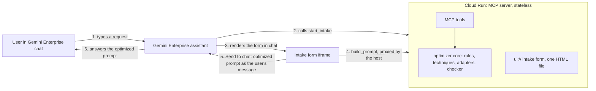
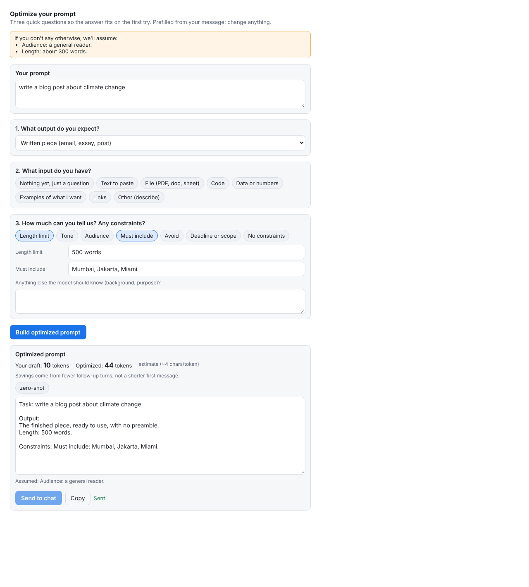

# Prompt Optimizer MCP

**Ask first, answer once.** An MCP server that asks three quick questions before the model answers, builds the leanest prompt that covers them, and checks the answer against what was asked, so you get the right answer in one turn instead of three.

Built for Gemini Enterprise first, designed for any LLM. Python 3.10, deploys to Cloud Run within the free tier. The optimizer itself makes **zero model calls**: every decision is a fixed rule, so it costs no tokens and gives the same prompt for the same answers.

---

## Contents

1. [The problem](#1-the-problem)
2. [The solution](#2-the-solution)
3. [How it differs from existing tools](#3-how-it-differs-from-existing-tools)
4. [Early results](#4-early-results)
5. [Architecture](#5-architecture)
6. [Project layout](#6-project-layout)

---

## 1. The problem

**What you want and what you get from an AI assistant are often different.** Fixing that gap costs tokens, time and accuracy.

| Problem | What happens | Why it costs tokens |
|---|---|---|
| **Vague requests** | "Write a blog post about climate change": no length, audience, focus or examples. The model guesses. | A wrong guess means a follow-up turn, and **every follow-up re-sends the whole conversation**. |
| **Missing context** | The model doesn't know who it's writing for or what you already have. | Generic answers need correcting, which means more turns. |
| **Several asks in one message** | "Explain X and also write quiz questions." One part often gets skipped. | Another turn to ask for the missing part. |
| **Wrong technique** | Most people don't know when to give examples, ask for step-by-step reasoning, or tell it to use only their material. | Worse first answers, more retries. |
| **Made-up facts** | Asked for statistics, sources or recent events, models can invent them confidently. | Retries, plus wrong information you might act on. |
| **Polluted history** | Wrong or corrected claims stay in the chat and keep influencing later answers. | Long, drifting threads, each turn paying for all of it again. |
| **Not everyone is a prompt engineer** | The rules for a good prompt (be specific, give context, set the format, add constraints, one ask at a time) are known, but users don't apply them. | All of the above. |

**The key insight:** the expensive part is rarely the first message. It's the **follow-up turns**, because each one re-sends the full history. Get the first prompt right and you skip those turns.

---

## 2. The solution

Three steps around every new task: **ask → build → check**.

```
 You type a rough request
          │
          ▼
 1. ASK      A short form, prefilled from your message:
             • What output do you expect?   (dropdown)
             • What input do you have?      (multi-select)
             • Any constraints?             (length, tone, audience, must include/avoid, scope)
          │
          ▼
 2. BUILD    Fixed rules turn your answers into the leanest prompt that covers them:
             picks the right technique, numbers multiple asks, adds "say if unsure"
             for risky facts, and attaches an output contract (format, length, required parts)
          │
          ▼
 3. CHECK    The answer is checked against the contract. If something is missing,
             ONE targeted follow-up fixes it, instead of a full retry
```

### Before and after (real output of the builder)

**Before**, what the user types:
```
write a blog post about climate change
```

**After**, once the form is answered (audience, 400 words, friendly, coastal cities, must include three cities):
```
Task:
You are a skilled writer, writing for: general readers.
write a blog post about climate change

Context: Scope: how rising seas affect coastal cities

Output:
The finished piece, ready to use, with no preamble.
Length: 400 words.
Tone: friendly.

Constraints: Must include: Mumbai, Jakarta, Miami.
```
Output contract checked afterwards: `words=320-480; must include Mumbai, Jakarta, Miami`.

### What it does, feature by feature

| Feature | What it does |
|---|---|
| **Intake form** | Three questions with dropdowns, prefilled from your own words. Every "Other" has a text box, so nothing you want is lost. |
| **Conflict check** | "Your prompt sounds like a comparison table but you picked code. Which is right?" |
| **Your prompting rules as checks** | Be specific, set the context, specify the format, use constraints, be clear (typo fixes), one ask per prompt, don't expect perfect answers. A failed check either **asks you** or applies a **visible default**. It never guesses silently. |
| **Technique picker** | Zero-shot by default; few-shot when you have examples; grounding when you have material; step-by-step for reasoning or decisions; role when an audience is named; rules first for standing rules; creative for ideas and stories. The lightest set that fits wins. |
| **Risk flags** | Requests for statistics, sources, quotes, real people or recent events add "say 'I'm not sure' instead of guessing; don't invent sources". |
| **Output contract and checker** | Format, length, item count, required and banned words. On failure: one follow-up that fixes everything at once. |
| **Token counts** | Shows the draft and the optimized prompt side by side, so the cost is never hidden. |
| **Context health and clean restart** | Flags long threads, repeated corrections and contradictions, and writes a short handoff prompt with only confirmed facts for a fresh chat. |
| **Works with any model** | One layout adapter per model (Gemini, Claude, generic) and one provider class per API. |

---

## 3. How it differs from existing tools

Existing prompt optimizers (browser extensions with an "Optimize" button, prompt scorers, and Anthropic's Console prompt improver) mostly do one thing: **rewrite your prompt before you send it, usually into a longer one.**

| | Typical optimizer extensions | Anthropic Console prompt improver | **This project** |
|---|---|---|---|
| **When missing info** | Rewrites and fills gaps with assumptions | Rewrites using best practices | **Asks you** (at most 3 questions) and shows every default it used |
| **Token cost** | Prompts usually get longer; scores focus on clarity | Adds chain-of-thought and examples, aiming for accuracy over speed | **Picks the lightest technique** and counts every token, including its own overhead |
| **Cost of the optimizer itself** | Often an LLM call per optimization | An LLM call | **Zero model calls**: fixed rules |
| **After the answer** | Stops once the prompt is sent | Not covered | **Checks the answer** against an output contract; one targeted follow-up |
| **Chat history** | Not covered | Not covered | **Context health check** and clean-restart handoff |
| **Made-up facts** | Not specifically | Not specifically | **Risk flags** add an explicit "say when unsure" rule |
| **Who it's for** | Chat users, one website at a time | Developers building apps | **Chat users in any MCP host** (Gemini Enterprise first) |
| **Proof** | Claims | Anthropic's own tests | **A benchmark you can rerun**, honest about where it loses |

The comparison with extensions is based on their store and directory descriptions, not hands-on testing; test the top few yourself before claiming these gaps publicly. The prompt improver column is based on Anthropic's announcement and docs.

**In one line:** others polish the prompt; this one **asks, builds lean, checks the answer, and measures the result.**

### What it does not solve

- **Model knowledge gaps.** A perfect prompt can't make a model know something it doesn't.
- **Fact-checking.** It flags risky claims; it can't verify them.
- **Simple questions.** The form adds overhead. On "What is the capital of Australia?" the tool costs more (see results).
- **The model's built-in memory**, separate from chat history.
- **Users who skip the form.**

---

## 4. Early results

First real runs on `gemini-3.8-flash` (1 November 2026). Total tokens to reach an answer that meets the user's criteria, **including re-sent history, thinking tokens and the tool's own overhead**:

| Task | Without the tool | With the tool | Turns | Change |
|---|---:|---:|---|---:|
| Blog post (2 runs, avg) | 5,550 | 2,444 | 2 → 1 | **−56%** |
| Explanation (2 runs, avg) | 4,228 | 2,060 | 2 → 1 | **−51%** |
| Comparison table (1 run) | 6,688 | 1,955 | 3 → 1 | **−71%** |
| Simple fact (1 run) | 92 | 1,249 | 1 → 1 | +1,258% |

**Reading it honestly:** where a vague prompt needs follow-ups, the tool roughly halved total tokens by getting it right first time. On a question the model already answers in one turn, it only adds overhead, so the planned **fast path** will skip the form for simple questions.

**Limits:** only 6 runs across 4 of 7 tasks; the checks are mechanical (length, format, required words), not quality; the follow-ups are scripted; the host overhead is estimated, not measured inside Gemini Enterprise. Treat these as early signals, not a result, until the full benchmark and a live Gemini Enterprise test are done.

---

## 5. Architecture



| Part | What it does | Why it is built this way |
|---|---|---|
| `optimizer/` | The prompting rules (be specific, context, format, constraints, typos, one ask per prompt, unsure facts), technique choice, per-model layout, output contract, answer checker, context health, handoff | Pure Python, no model, no MCP. The same core runs in the server, the benchmark and tests. |
| `server/app.py` | MCP server: 5 tools, 2 resources, 1 prompt, the intake form, a health route | Stateless Streamable HTTP with plain JSON replies, so Cloud Run can scale to zero and any instance can answer any call. |
| `server/widget/intake.html` | The 3-question form (MCP App), prefilled from the draft | One self-contained file. The official MCP Apps SDK is inlined, so no CDN script can be blocked by the host's sandbox. |
| `server/auth.py` | Checks the user's Google OAuth token | Gemini Enterprise sends two tokens: Cloud Run checks the service agent's, this checks the user's. |
| `llm/` | Provider interface: `GeminiProvider` (google-genai) and a `FakeProvider` for dry runs | The server needs no model. Only the benchmark (and optional exact token counts) use it. Add a class here for another LLM. |
| `bench/` | Token benchmark: with vs without the tool | Counts every token, including re-sent history, thinking tokens and the tool's own overhead. |



### Tools

| Tool | Type | Input | Output |
|---|---|---|---|
| `start_intake` | Tool with MCP App form | The user's draft prompt | The form, prefilled; numbered text questions as fallback |
| `build_prompt` | Tool | Draft plus intake answers | Optimized prompt, output contract, techniques, assumptions, token counts |
| `check_output` | Tool (optional) | Contract plus the model's reply | Pass/fail per item, one follow-up that fixes all failures |
| `context_health` | Tool (optional) | Turn count, corrections, contradictions | good / watch / restart, with reasons |
| `make_handoff` | Tool (optional) | Confirmed facts, decisions, open task | A short prompt for a fresh chat |
| `optimize` | Prompt | Draft | Shortcut into the intake where the host shows MCP prompts |
| `playbook://techniques`, `playbook://models/{name}` | Resources | — | Technique rules and per-model layout notes |

### Request flow

1. The user types a request, e.g. "write a blog post about climate change".
2. The assistant calls `start_intake(draft)`. The server reads the draft and guesses the answers (output type, inputs, length, tone, audience).
3. The host shows the form, prefilled. If the draft and the user's choice disagree ("sounds like a table, you picked code"), the form asks which is right.
4. The user clicks **Build**. The form calls `build_prompt` through the host. The server runs the rules, picks the technique, and returns the optimized prompt, its output contract, any assumptions and token counts.
5. The user clicks **Send to chat**. The optimized prompt goes into the chat as the user's message (`ui/message`). If the host doesn't allow that, the user copies and pastes it.
6. The assistant answers the optimized prompt.

**Fallback.** If a host cannot show the form, `start_intake` returns the same three questions as numbered text. The assistant asks them in chat and calls `build_prompt` itself.

### Design decisions

- **Rules, not a model, decide the prompt.** A model-based optimizer spends tokens to save tokens. Here the only extra tokens are the tool definitions and the intake call, and the benchmark counts them.
- **Ask, don't assume.** A missing essential becomes a question. A missing nice-to-have (length, audience) becomes a visible default, listed as an assumption, never a silent guess.
- **Lightest technique wins.** Zero-shot unless a signal fires: examples → few-shot, your material → grounding, reasoning or a decision → step-by-step, named audience → role, standing rules → rules first, ideas or stories → creative.
- **Lean tool definitions.** Hosts send every enabled tool's definition to the model on every turn. The schemas are trimmed, and you enable only `start_intake` and `build_prompt` in Gemini Enterprise (about 300 tokens per turn by the local estimate).
- **One follow-up, not a retry.** When an answer misses the contract, the checker writes one message that fixes every failure at once.
- **Generalised.** `target_model` picks a layout adapter (`gemini`, `claude`, `generic`); `llm/` holds providers. Both are one small class per model.

### Two-layer auth (from Google's custom MCP server docs)

| Layer | Header | Checked by | Question it answers |
|---|---|---|---|
| 1 | `X-Serverless-Authorization`: Google-signed ID token of the Gemini Enterprise service agent | Cloud Run IAM (`roles/run.invoker`) | Which service may call? |
| 2 | `Authorization: Bearer <user's OAuth access token>` | `server/auth.py` via Google's tokeninfo endpoint; the token must be issued to **your** OAuth client | Which user is calling? |

Google's docs say the ID token is sent only to default `*.run.app` URLs, not custom domains, so keep the default URL.

---

## 6. Project layout

```
optimizer/   models, vocab, rules, techniques, adapters, builder, checker, context, tokens
llm/         base types, gemini provider, fake provider
server/      app (MCP server), auth, config, widget/intake.html, widget/vendor (MCP Apps SDK, MIT)
bench/       tasks.json, run_benchmark.py, report.py, import_log.py
deploy/      deploy.sh (Cloud Run)
scripts/     vendor_ext_apps.py (re-vendor the MCP Apps SDK)
docs/        widget.png
tests/       core, HTTP + auth, Gemini provider, benchmark, widget in a real browser
```

---

